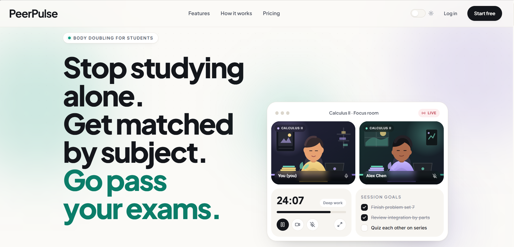
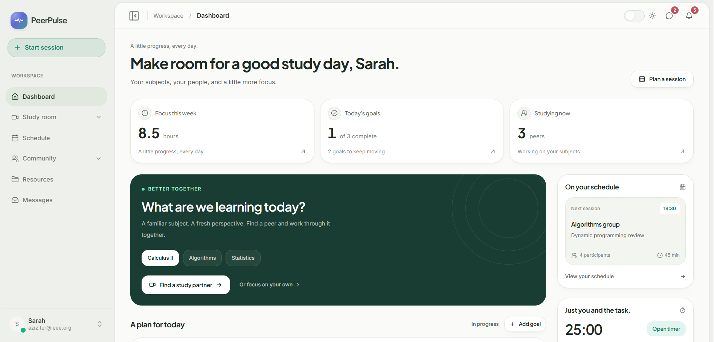
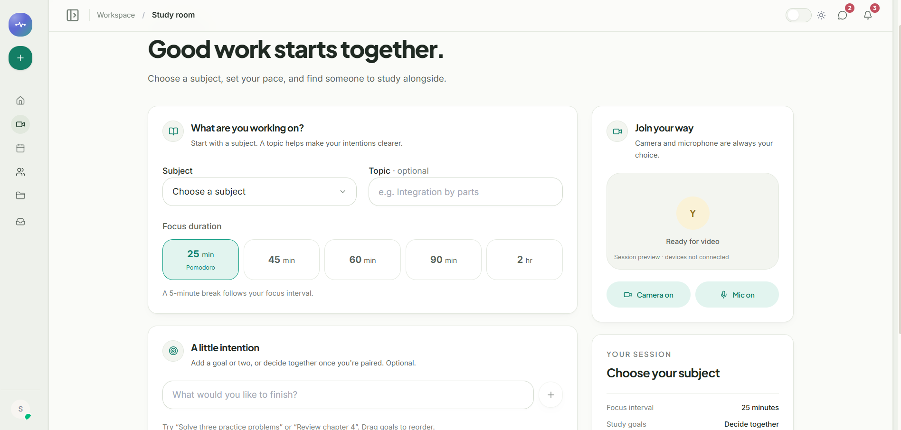
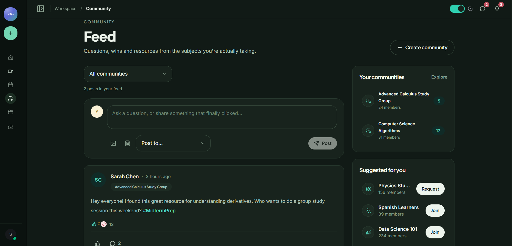

<div align="center">

# PeerPulse

### Study together. Stay focused. Make progress.

**A student-focused collaborative learning platform — currently a frontend prototype.**

Explore study partners, focus sessions, communities, and a shared learning workspace through a modern, responsive interface.


</div>



> **Prototype preview:** Screenshots show the UI with illustrative content. Peer matching, live video and persistent shared services are not connected yet.

---

## The idea

Studying alone can make it difficult to stay accountable, find someone working on the same subject, or get quick help when you're stuck.

**PeerPulse** explores a shared space where students can discover study communities, plan focused sessions, organize their goals, and connect with other learners. The long-term vision includes real-time collaboration and AI-assisted learning.

This repository documents the **interface and interaction prototype**. Not all envisioned collaboration features are connected to live services.

## What's in the prototype

| Area | Current experience |
| --- | --- |
| **Dashboard** | Study goals, progress summaries, suggested peers, and quick links into study modes |
| **Focus sessions** | Session setup, Pomodoro-style timers, study goals, and a mock partner experience |
| **Solo study** | A standalone focus-and-break timer |
| **Group study** | Example rooms and room-selection interface with a local focus timer |
| **Communities** | Community directory, subject filters, simulated membership requests, and a post/feed interface |
| **Messages** | Conversation UI with locally managed message threads and attachments |
| **Schedule** | Calendar-based session planning in a single-visit preview |
| **Resources** | File-selection and browsing interface for a local study-materials preview |
| **Profile** | Student profile, subjects, and sample activity/statistics views |

These features are represented in the source, but several use **sample data or local React state** instead of a connected backend.

## Interface highlights

- Responsive layouts for a student-oriented dashboard and study workspace.
- Reusable UI components, including dialogs, drawers, forms, cards, and navigation.
- Study timers, goal-setting interactions, and preview session flows.
- Community discovery, search, filters, and membership-state interactions.
- Accessible labels and interaction states across several screens.

## Interface gallery

| Student dashboard | Study room setup |
| :---: | :---: |
|  |  |

**Community feed — dark theme**



*Screenshots were captured from the local frontend prototype and include sample profiles, posts, and session information.*

## Tech stack

| Layer | Tools |
| --- | --- |
| Framework | Next.js 15 (App Router) |
| UI | React 19, TypeScript |
| Styling | Tailwind CSS, CSS variables |
| Components | Radix UI primitives, custom UI components |
| Animation | Framer Motion |
| Icons | Lucide React |
| Interactions | dnd-kit, React state and browser APIs |
| Document previews | React PDF / PDF.js |

**Backend / realtime services:** Not implemented in this repository at this stage. The current auth provider uses local browser storage; real user accounts, live peer matching, persistent communities, and camera/microphone sessions require additional integration.

## Project status

**Portfolio showcase · Frontend prototype**

PeerPulse is shared here to present the product concept, interface design, and frontend engineering work. It is **not offered as a hosted service, installable product, or supported application for third-party deployment**.

The current experience uses example data and local interactions in several areas. Real user authentication, persistent storage, live peer matching, and actual camera/microphone sessions are planned rather than production-ready.

## Project structure

```text
app/
  page.tsx                  # Landing page
  (app)/
    dashboard/              # Study dashboard
    study/                  # Focus session and solo/group views
    community/              # Community feed
    communities/            # Community discovery
    messages/               # Messaging interface
    schedule/               # Scheduling preview
    explore/                # Study materials
    profile/                # Profile and activity views
components/
  community/                # Community interfaces
  marketing/                # Landing page demonstrations
  realtime/                 # Collaboration-oriented UI components
  ui/                       # Reusable interface primitives
  focus-timer.tsx           # Focus/break timer
docs/
  PLAN.md                   # Proposed product architecture and next steps
```

## Current status and roadmap

The latest work focuses on the **frontend redesign and interaction flows**. This is not yet a production service, and the interface should not be interpreted as evidence of operational real-time collaboration.

**Still to build or integrate:**

1. Persistent accounts, sessions, and data storage.
2. Real peer matching and synchronized study rooms.
3. Camera/microphone communication and live presence.
4. Persistent communities, messages, resources, and scheduling.
5. AI study assistance and production-ready testing.

For the longer-term architecture proposal, see [the development plan](docs/PLAN.md).

---

<div align="center">

**Built as a hands-on product and frontend engineering project by [Aziz Ferchichi](https://github.com/Azizfer).**

[GitHub Profile](https://github.com/Azizfer) · [LinkedIn](https://www.linkedin.com/in/aziz-ferchichi-499742218)

</div>
